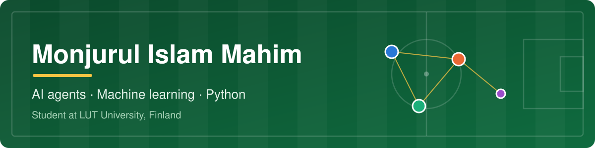
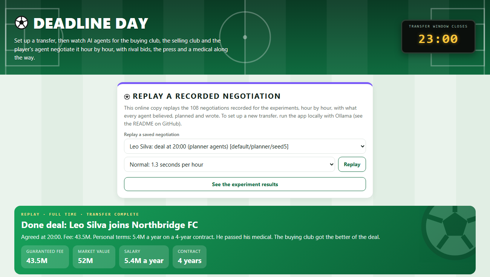

  
  

## About me

- 🎓 Student at **LUT University**, Finland
- 🤖 I build **AI agents** that plan, reason about other parties and use language models where they are strong
- 🔬 Currently exploring how planning and small, local language models can work together
- ⚽ Interested in applying AI to sports and real-world decision making

## Featured project

<table>
<tr>
<td width="50%">

</td>
<td width="50%">

### [⚽ Deadline Day](https://github.com/MjMahim/deadline-day)

AI agents for two football clubs and a player's agent negotiate a transfer on deadline day, with rival
bids, release clauses and a medical.

Inspired by Meta's **CICERO**, a planner in code decides every move and a local **Qwen3 8B** model only
reads and writes the messages.

- **0** rules broken, **0 of 9** deals overpaid
- A plain LLM agent overpaid in **8 of 11**
- **108** recorded negotiations

[**▶ Replay them in your browser**](https://mjmahim.github.io/deadline-day/)

</td>
</tr>
</table>

## Tech stack

  

**AI and ML:** language-model agents · Bayesian opponent modelling · multi-agent simulation · experiment design 
**Tools:** Ollama · matplotlib · LaTeX · GitHub Pages
